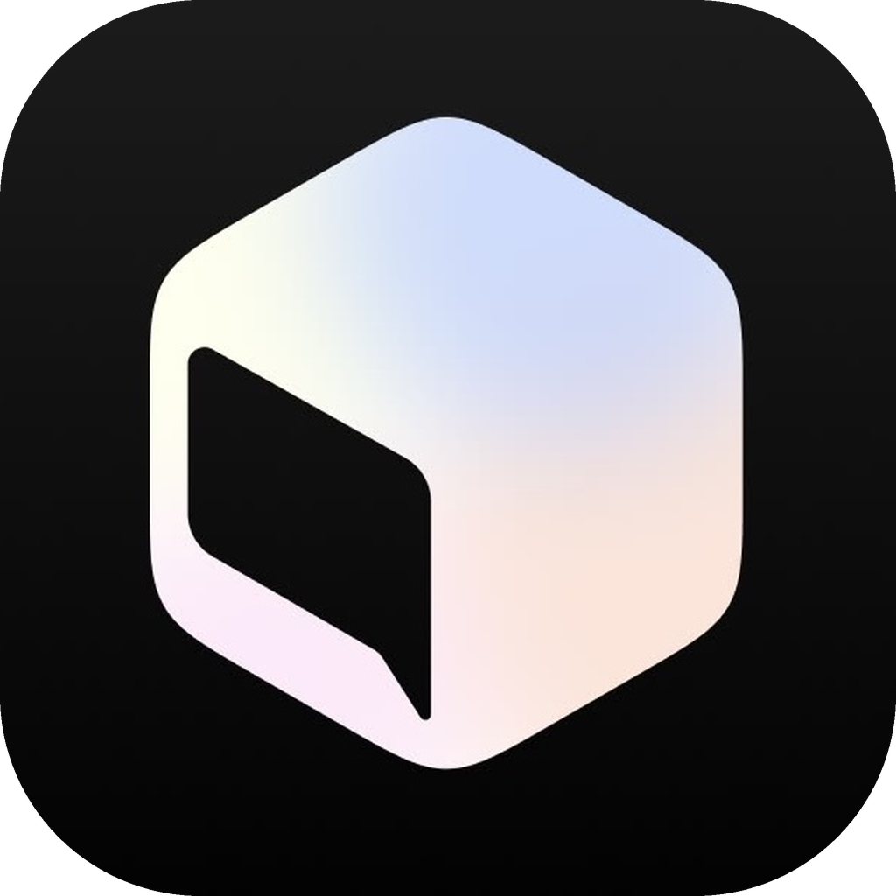

<p align="center"></p>

<h1 align="center">UABE for iOS</h1>

<p align="center">
  A full Unity AssetBundle viewer and editor that runs <b>entirely on your iPhone or iPad</b>.<br>
  No computer. No server. Fully open source.
</p>

<p align="center">
  
  
  
  
  
</p>

---

Open a bundle, browse every object inside it, preview textures, meshes and audio, and replace them with your own files. You can even paint directly on textures.

UABE for iOS is a port of [UABE-Android](https://github.com/elfilibusterismo/UABE-Android). The interface is rewritten in SwiftUI and the engine is [UnityPy](https://github.com/K0lb3/UnityPy) running inside an embedded CPython.

## Highlights

- **Everything on the device.** Edit bundles without a PC or Mac.
- **Texture editor.** Brush, eraser, shapes, fill and eyedropper, with unlimited undo.
- **Meshes, audio, text and JSON** in one app.
- **Sync bundles.** Copy assets from one bundle into another, for example Android build into iOS build.
- **Safe by design.** Your original file is never touched, and every edit can be undone.
- **Wide Unity support.** Built on UnityPy, which supports Unity 3.0 and newer.

## Features

**Opening files**
- Open `.unity3d`, `.bundle` and `.ab` files from the Files app, or send them from another app with "Open in".
- Recent files list (last 15) with swipe to delete, and the last bundle reopens on launch.
- Decryption key support for encrypted bundles.

**Browsing**
- Every object is listed with its name, type, size, index and path ID.
- Search by name, type or ID.
- Filter by type, size range, or "edited only".
- Sort by index, name, type, size or modified state.
- Quick type chips with counts, swipe a row to open or export it, edited objects are marked, pull down to reload.
- A home screen with your recent bundles.

**Textures (Texture2D)**
- Preview, export as PNG, and replace with an image from the Photo Library or Files. The new image is resized to the original width and height automatically (can be turned off in Settings).
- **Built-in texture editor:** draw directly on the texture instead of replacing it.
  - Tools: brush, eraser, line, rectangle, ellipse (outline or filled), paint bucket with tolerance, eyedropper.
  - Any color, size and opacity sliders, unlimited undo/redo, pinch to zoom and two-finger pan.
  - Flip, invert, clear, reset to the original and export PNG from the menu.
  - Press **Apply** to write your drawing into the bundle.
- Decoders for DXT/BC, ETC, ASTC, PVRTC, ATC and Crunch. If ASTC encoding fails during replacement, the image is saved as RGBA32 instead, keeping the original dimensions.

**Meshes**
- Interactive 3D preview (rotate and zoom) and export as OBJ.

**Audio (AudioClip)**
- Listen to the current audio inside the app, including Vorbis clips.
- Export as WAV (PCM), MP3, OGG (Vorbis) or M4A (AAC).
- Replace a clip with an audio file (MP3, M4A, WAV, ...) or with the sound of a video (MP4/MOV). You can play the new audio before you apply it.
- Clips in formats that cannot be decoded on iOS are exported as the raw `.fsb` bank.

**Sync bundles**
- Copy every matching Mesh, Texture2D and TextAsset from one bundle into another. Objects are matched by name or path ID, you review the matches, untick what you do not want, and apply.
- Texture images are decoded and re-encoded for the target, keeping its name and dimensions by default. TextAssets are copied through their parsed content.
- Mesh raw data is copied only when Unity versions match. Mismatched versions are skipped to avoid invalid object data.

**Raw and dump (any object type)**
- Export an object as raw bytes (`.dat`) or as a readable dump (`.json`), and import them back into another object or another bundle.
- Raw import is checked when saving. If the data cannot be read for that object, nothing is written and the original is restored. If bone count, skin weights, compression or vertex count differ from the object you replaced, you get a warning.

**Text and data**
- Edit TextAssets directly.
- Edit any other object (MonoBehaviour and so on) as JSON through its TypeTree.

**Saving**
- Changes are saved automatically to a private working copy.
- Choose the compression for saved bundles: keep original, none, LZ4, LZ4 HC or LZMA.
- A CRC32 checksum is shown after saving.
- **Export (Save As...)** writes the modified bundle anywhere in Files.
- Light, dark or system theme, plus cleanup tools for temporary and recent files, in Settings.

## Unity version support

UABE for iOS reads bundles through [UnityPy](https://github.com/K0lb3/UnityPy), which supports Unity versions from 3.0 up to current releases, including Unity 6. The app itself does not restrict versions. A few operations depend on versions matching, such as copying raw mesh data between bundles, and the app warns or skips those cases.

## Safety and privacy

- **Open source.** All the code is public, so you can read it before you trust it.
- **On-device only.** Bundles are processed locally. There is no server and no account.
- **Your original is never touched.** Opening a bundle copies it into the app, and all edits happen on that private copy.
- **Automatic backup and history.** The original is kept next to the working copy, and edits are tracked per object, so you can restore one object or the whole bundle.
- **Validated imports.** Raw imports are checked on save. Invalid data is rejected and the original is restored.
- **Verified saves.** After each save the bundle is reopened and checked.

Use this tool only on files you own or have permission to modify.

## Using the app

1. Tap the folder button, pick **Browse** and choose a bundle. It is copied into the app, your original file stays as it is.
2. Tap an object to preview or edit it. Long press for export and import shortcuts.
3. For audio: open the clip, press **Play**, then **Replace with audio...**, choose a file, listen to it and press **Apply replacement**.
4. Open the menu (top right) and choose **Export (Save As...)** to get the modified bundle out of the app.

If something looks wrong, **Menu > Diagnostics** lists which libraries loaded.

## Limitations

- Audio replacement stores the new clip as uncompressed PCM, so the bundle gets bigger. The old audio stays inside the file.
- Audio that lives in a separate file outside the bundle cannot be replaced.
- ADPCM and other exotic audio formats are exported raw instead of decoded.
- Mesh import from `.obj` is not available. Use Raw/Dump import to move meshes between bundles of the same game and Unity version.
- arm64 devices only (no Intel simulator).
- The build is unsigned, you sign it when you install it.

## Building

### With GitHub Actions (no Mac needed)

1. Fork this repository, or create your own and upload these files.
2. Open the **Actions** tab, enable workflows if asked, choose **Build iOS IPA** and press **Run workflow**.
3. When it finishes (around 15 to 25 minutes), download the **UABE-ipa** artifact. Inside the zip is `UABE.ipa`.
4. Install the unsigned IPA with a sideloading tool that signs it for you: Sideloadly, AltStore, or TrollStore on supported iOS versions.

If the build fails, download the **build-log** artifact and look for lines starting with `error:`.

### On a Mac

Requirements: macOS with Xcode 16 or newer, Python 3.13, and XcodeGen (`brew install xcodegen`).

```bash
bash scripts/fetch_deps.sh
bash scripts/stage_python.sh
xcodegen generate
xcodebuild build -project UABE.xcodeproj -scheme UABE -configuration Release \
  -sdk iphoneos -destination 'generic/platform=iOS' -derivedDataPath build \
  CODE_SIGNING_ALLOWED=NO CODE_SIGNING_REQUIRED=NO CODE_SIGN_IDENTITY=""
bash scripts/package_ipa.sh
```

`UABE.ipa` appears in the project folder. Python code is shipped as bytecode only. Run `PROTECT=0 bash scripts/stage_python.sh` if you want plain `.py` files in your own debug build.

To run the backend tests on any machine with Python:

```bash
python3 tests/test_backend.py
python3 tests/test_sync.py
```

## How it works

- **App** (`App/`): SwiftUI interface. A small Objective-C layer starts CPython 3.13 inside the app, and Swift talks to it through JSON messages on a dedicated thread.
- **Backend** (`python/uabe_backend.py`): the bundle logic, built on UnityPy. Large data is exchanged through files, not JSON.
- **Native codecs** (`native/`): texture decoders, etcpak, ASTC and libogg/libvorbis are compiled as frameworks and loaded from Python with ctypes.
- **Audio** (`python/uabe_audio.py`): reads FSB5 containers, rebuilds Ogg Vorbis, and writes the PCM FSB5 used for replacements. The new audio is appended to the bundle's `.resource`/`.resS` stream and the clip's offset and size are updated.
- **Compression**: `lz4` and `brotli` are small replacements that use Apple's libcompression, so no extra wheels are needed.
- **Build**: `project.yml` is turned into an Xcode project by XcodeGen. The scripts in `scripts/` download Python for iOS, UnityPy and the native sources.

```
App/        SwiftUI app and the Objective-C Python runtime
python/     backend, audio support and the small compatibility modules
native/     C/C++ sources built as frameworks
scripts/    dependency download, packaging
tests/      backend tests
docs/       icon and documentation assets
```

## Credits

Based on [UABE-Android](https://github.com/elfilibusterismo/UABE-Android). Built with UnityPy, Texture2DDecoder, etcpak, astc-encoder, libogg, libvorbis, python-fsb5, BeeWare's Python-Apple-support and XcodeGen. Licenses are listed in [THIRD_PARTY_NOTICES.md](THIRD_PARTY_NOTICES.md).

Developer: [@frezcode on TikTok](https://www.tiktok.com/@frezcode)

---

# بالعربي

<p align="center"><b>UABE for iOS</b> تطبيق مفتوح المصدر لتصفح وتعديل ملفات Unity AssetBundle على الآيفون والآيباد مباشرة، بدون كمبيوتر.</p>

**المميزات**
- فتح ملفات `.unity3d` و`.bundle` و`.ab`، مع قائمة الملفات الأخيرة ودعم مفتاح فك التشفير.
- بحث وفلترة وترتيب للكائنات.
- **الصور:** معاينة وتصدير PNG واستبدال من مكتبة الصور أو الملفات، مع الحفاظ على الحجم الأصلي.
- **محرر الرسم:** ارسم مباشرة على الصورة بفرشاة وممحاة وأشكال وتعبئة وقطارة، مع تراجع وإعادة غير محدودين.
- **المجسمات:** معاينة ثلاثية الأبعاد وتصدير OBJ، واستيراد Raw/Dump بين الملفات.
- **الصوت:** تشغيل الصوت الحالي، تصدير WAV وMP3 وOGG وM4A، واستبدال الصوت بملف صوت أو فيديو مع سماعه قبل التطبيق.
- **النصوص وبقية الكائنات:** تعديل كنص أو JSON.
- **Sync bundles:** نسخ المجسمات والصور والنصوص من ملف إلى آخر مع مراجعة المطابقات قبل التطبيق.
- **الحفظ:** حفظ تلقائي، واختيار الضغط (LZ4 وLZ4 HC وLZMA)، وعرض CRC32، وتصدير الملف المعدّل (Save As)، ووضع فاتح وداكن.

**إصدارات Unity**
يعتمد التطبيق على UnityPy الذي يدعم Unity من الإصدار 3.0 حتى الإصدارات الحديثة بما فيها Unity 6.

**الأمان والخصوصية**
- الكود مفتوح للجميع.
- كل المعالجة تتم على جهازك، بدون سيرفر وبدون حساب.
- ملفك الأصلي لا يُلمس أبداً، وكل التعديلات على نسخة خاصة داخل التطبيق.
- نسخة احتياطية وسجل تعديلات، فتقدر تسترجع كائناً واحداً أو الملف كاملاً.
- التحقق من البيانات المستوردة، وفحص الملف بعد كل حفظ.

**البناء بدون ماك**
1. ارفع المشروع إلى مستودع GitHub خاص بك.
2. من تبويب Actions شغّل **Build iOS IPA**.
3. نزّل الملف `UABE-ipa` من Artifacts، وفيه `UABE.ipa`.
4. ثبّته عبر Sideloadly أو AltStore أو TrollStore (الملف غير موقّع، والأداة توقّعه لك).

**ملاحظات**
- استبدال الصوت يحفظه كـ PCM غير مضغوط، فيكبر حجم الملف.
- الصوت المخزّن في ملف خارج الـ Bundle لا يمكن استبداله.
- استيراد المجسمات من `.obj` غير متاح حالياً.
- الأجهزة المدعومة: arm64 فقط، وiOS 16 أو أحدث.
- استخدم الأداة فقط على ملفات تملكها أو لديك إذن بتعديلها.
